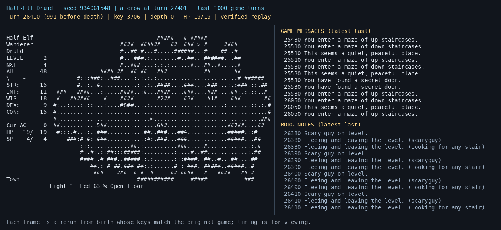

<!-- generated by scripts/death_pages.py -->

# D-d6d6e1289979c8a9fc6541e54c632208a28081d7f46a9b94659ea0d73eb251c4 · Half-Elf Druid

Published alias: `D-d6d6e1289979c8a9fc6541e54c632208a28081d7f46a9b94659ea0d73eb251c4`. Canonical identity: [death-id.json](death-id.json).

**Seed: `934061548`**

| Detail | Value |
| --- | --- |
| Cause | a crow |
| Death turn | 27401 |
| Program version | [f02cd2940a7439a8965b3883270a9a73df7e0bf5](https://github.com/diegoami/borg-reborn-rs/commit/f02cd2940a7439a8965b3883270a9a73df7e0bf5) |

## Build, watch or play

From this directory, run `./build.sh`, then `./watch.sh`. Use `./watch.sh --verify-only` for a verification without opening the player. Where a starting save is retained, `./play.sh --label "My attempt"` records an alternative human continuation and adds it to this report. Historical cases lacking a recording/save explain that limit instead of inventing playback.

## What happened

Half-Elf Druid, character level 2, depth 1 (max 1), seed 934061548, implementation `rust`, flags `-`.

Build `f02cd2940a7439a8965b3883270a9a73df7e0bf5` (dirty: no), binary `9728702e34ea`. Keys `b08aec02a1c3`; raw logs stay in `/tmp/claude-1000/-home-diego-projects-angband-borg-zoo/8e883c1d-7aa1-4ec6-8b49-b95ddfa42a6c/scratchpad/work/classes-18/4.2.6-reborn-rust-heal/reborn-heal1-trip1-attack1-plan/934061548` (not committed).

Core decision trace: the last 200 of 2694 thinks in `trace-core-tail.jsonl`, with selected check, queued keys and `params-core.json`.

**Unassessed.** Basic dossier written by `tools/export-death.py` at the end of the run (RULES 12). Upgrade it with the full death tooling (T1.6) before investigating.

## Last turns before the death

Each frame is a rerun from birth stopped at that key, with keys matching the original game (`scripts/animate_death.py`). The receipt beside each animation lists every frame.

**Last 1000 game turns** · [receipt](media/last-1000-turns.json)

## Read and replay

- [Original written report](report.md)
- [Recording download and replay instructions](REPLAY.md)

A complete recorder recording is not retained for this case. The replay instructions distinguish a seed rerun from playback of an original recording.

Original reports and evidence are preserved as written. Historical aliases are scoped to their registry; repeated attempts are not independent deaths.

[Parent record or registry](../README.md)
