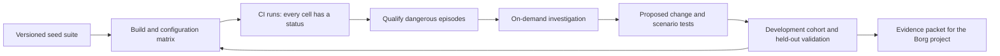

# Cemetery redesign: controlled runs and reproducible dangerous scenarios

Status: owner-requested design proposal, 2026-11-15. **Not implemented or an
accepted milestone.** This proposes the next architecture; it does not change
the M1 review boundary, run new games, provision services or delete evidence.

## What the cemetery should answer

For a fixed set of starting conditions, does build B with configuration Y do
better than build A with configuration X? Where did it become exposed to death,
what could it have done differently, and does that change help elsewhere?

The current historical statistics cannot answer that question. They inventory
selected death dossiers, without a complete cohort of survivors and failures.
Generating more permanent death pages would preserve that limitation. The unit
of work should be a controlled experiment, with deaths and dangerous recoveries
as evidence inside it.

The proposed loop is:



## 1. Fix the cohort and identify configurations properly

Start with one versioned suite containing **64 seed cases**: 32 development
cases and 32 held-out validation cases. This is a bounded pilot, not a claim
that 64 cases can establish small survival gains. Choose the seeds once, before
looking at outcomes. Each case binds a seed to race, class, birth options,
calendar/time inputs and any other initialization randomness. Publish character
coverage in the suite; do not silently make every seed/class combination an
extra case. Fix the engine-turn horizon and progress checks in its run contract.
Changing the cohort or horizon creates a new suite/contract revision.

Keep up to **three active builds and four active build/configuration variants**
initially: a reference, a candidate and a recent comparison build. Configurations
consume variant slots; this is not an unlimited Cartesian product. For example,
reference/default, candidate/default, candidate/tuning-A and previous/default
give 64 × 4 = 256 cohort cells. Tune on the 32 development cases and the scenario
bank; run held-out validation for a frozen finalist. Unscheduled cells remain
visible as such. This avoids paying for a full validation sweep after every edit.

A variant is an immutable **build identity plus effective configuration**:

| Identity | Required contents |
| --- | --- |
| Build | Project; resolved commit; source-input digest; clean/dirty status; exact binary/runtime digest; engine/data identity; compiler/build flags; instrumentation and recorder versions |
| Effective configuration | All resolved defaults and overrides, with names/types/schema version; profile contents; native game and Borg options; selected core; relevant environment inputs |
| Run contract | Seed suite revision; birth/calendar rules; turn horizon; wall/resource limits; harness version; stopping/progress rules; observation contract |

Record both requested and engine/Borg-reported values. A profile filename or
commit alone is insufficient. Canonicalize and hash resolved configuration,
retain its readable parameter table, and reject unknown or silently ignored
overrides. A build lacking introspection is explicitly unqualified for a
controlled parameter comparison until its adapter provides it. For dirty source,
keep the exact input snapshot or refuse a reconstructable-build designation.

Define a cohort cell by `(suite revision, case, variant, run contract)` and give
each execution a separate attempt ID. Retries, recorder verification, human
branches and saved-position trials reference that cell; none creates another
independent seed case. Reuse an already verified identical cell unless an
explicit diagnostic repeat is requested. Initially select the first valid
primary gameplay attempt. Infrastructure failures permit a new primary attempt;
recorded deaths and gameplay stalls cannot be replaced by favorable retries.
Diagnostic repeats remain separate from the cohort result.

Different Borg builds are deliberately allowed. Matching engine/data and birth
contracts permit the strongest paired comparison. Different engines require a
separately qualified whole-system comparison, with the change disclosed. Equal
seed numbers do not guarantee equal worlds after engines or decisions diverge.

## 2. Store documents and artifacts outside Git

Use **PostgreSQL with JSONB documents for metadata**, and an **S3-compatible
object store for large artifacts**. This is a design recommendation: stable
identity/status fields belong in constrained columns, while versioned analysis
and configuration documents can evolve. PostgreSQL supports indexed JSONB and
compound uniqueness/foreign-key constraints, which fit both needs.
([JSONB documentation](https://www.postgresql.org/docs/current/datatype-json.html),
[constraints](https://www.postgresql.org/docs/current/ddl-constraints.html).)

This needs one durable database, one artifact bucket and a small coordinator
API/CLI; GitHub Actions remains the execution worker. No separate document
database, search cluster or queue service is needed for the initial scope.
Provider, hosting and cost limits remain deployment decisions. A local developer
instance can use the same PostgreSQL schema and a filesystem artifact backend;
do not synchronize a mutable database file by committing it from CI.

| Record | Purpose and links |
| --- | --- |
| Suites and cases | Immutable seed/birth membership, split and contract revisions |
| Builds, configurations, variants | Exact runtime identity and effective settings, independent of display labels |
| Campaigns and cells | Explicit requested matrix, reference/candidate roles, selection rule and completion coverage |
| Attempts | Status, timestamps, seed verification, terminal summary, progress, actor/attempt role and artifact references |
| Episodes | Original attempt, adaptive boundaries, evidence grade, qualification method/version and availability |
| Scenarios and trials | Exact start/save/runtime dependencies, continuation mode, alternative variant and outcome |
| Investigations and proposals | Evidence references, hypotheses, competing explanations, candidate changes and validation results |
| Artifacts and retention pins | Content digest, object location/size, owners, expiry, reconstruction dependencies and deletion receipt |

Full observations, thoughts, input streams, saves, runtimes, GIFs and generated
reports are compressed objects, not one database document per game tick. Chunk
long streams and index turn ranges so an investigation can fetch one episode.
Objects with identical bytes can share storage; their owners remain distinct.

Git keeps tools, schemas, suite definitions, experiment specifications, design
decisions and a small curated regression-fixture manifest. Routine new run data,
death pages and the growing statistics snapshot leave the Git publication path
once the new backend is qualified. Existing published cases remain reachable
during migration; there is no bulk history rewrite in this proposal.

### CI execution and durable publication

1. The coordinator registers the whole requested matrix before building. It
   resolves immutable versions and issues attempt IDs plus expiring worker leases.
2. CI builds each runtime once and uses a verified shared cache. Each seed runs
   with a clean, explicit environment. Requested and actual identities are checked.
3. A separate trusted publication step uploads immutable objects, verifies their
   digests, then transactionally commits their manifest and the attempt outcome.
   Candidate executable processes receive no database or deletion credentials.
4. Lost runners leave expired/incomplete attempts; retries get new IDs. Idempotent
   finalization and lease fencing prevent late workers from replacing a newer
   result. Orphan uploads are collected after a grace period.

Natural death, alive at horizon, win, policy stop, stall, timeout, infrastructure
failure and identity/configuration mismatch are distinct. Reports show all
requested cells and missing results. Failure to execute is never survival.

## 3. Qualify real near-deaths independently of the Borg

Use the following labels. The existing HP/Borg-risk heuristic only produces
**screening candidates** and must never directly increment a near-death count.

| Label | Required evidence |
| --- | --- |
| Death | Engine-confirmed natural death and terminal cause, bound to the actual run |
| Qualified near-death | Survived a credible immediate lethal exposure, independently verified from engine mechanics, followed by observed recovery |
| Hazard candidate | Potential danger detected, but lethal exposure or recovery is not established |
| Rejected candidate | Inspection establishes that the screening signal did not represent such an exposure |

For the first qualifier, evaluate **hostile actions and ongoing effects due
before the next legal player decision**, after the chosen action has committed.
Use actual energy/speed ordering, positions/line of sight, attack eligibility,
damage distributions, resistances, status effects and residual damage. Log the
decision and engine-event indices; several attacks can occur inside what a
coarse turn log presents as one interval. Full HP can still be lethal exposure;
low HP in a safe room is not one.

Where native instrumentation or a verified diagnostic replay can enumerate the
immediate outcome distribution, calculate lethal probability independently of
the Borg's estimate. Require a nontrivial probability threshold, chosen through
calibration, rather than merely a theoretical maximum-damage roll. A sustained
hazard such as starvation may need a separate validated qualifier: time to
unavoidable damage and available feasible relief, with its own evidence.
Unsupported mechanics remain unqualified. Do not invent a universal probability
from a single observed trajectory or silently trust the same Borg threat code
that is under investigation.

Survival of one attack is not recovery. Follow the episode until independently
observed exposure subsides for a calibrated decision interval; death before that
is part of the death episode. End-of-run or missing evidence produces a hazard
candidate with unresolved outcome. Merge overlapping alarms from one crisis.

Calibrate against reviewed positive and negative fixtures: safe low HP, fear
without attack opportunity, resisted damage, full-HP lethal bursts, fast multiple
attacks, poison, emergency healing and strategic depletion. Record precision and
misses, sampling ordinary/high-HP runs as well as triggered candidates. Freeze
the detector/qualifier version for a campaign; requalification is a separate
versioned result. The probability threshold, recovery interval and acceptable
error bounds are open pilot decisions, not constants justified by this document.

Engine truth can explain danger the Borg did not know about. Reports distinguish
that diagnostic information from the observations available to the Borg when it
acted. Neither an analyst nor a tested policy receives hidden information as a
normal gameplay input.

## 4. Reconstruct the sequence and make executable scenarios

Infer an episode from the last supported reasonably stable state through the
crisis and death or recovery. Extend backwards when preparation, depletion,
navigation or a mistaken belief explains the later exposure. Retain both the
immediate incident and links to earlier relevant decisions. There is no fixed
10/20/30-turn definition, and a chosen starting point is a documented inference,
not proof that the character was safe.

During collection, keep periodic checkpoints and a bounded recent observation
buffer. A trigger preserves the relevant checkpoint and stream chunks before
they are overwritten. Earlier strategic context comes from the compact birth
recipe/input stream and verified reconstruction. A buffer cannot guarantee that
it captured every root cause; report missing context and reconstruct when possible.

Reconstruction requires more than a seed. Retain a recipe containing all birth
randomness, fixed calendar/options, effective configuration, runtime/data digests,
input/RNG contract and periodic world-state digests. Keep the exact runtime
package once per build, including required data and dependencies. Source-only
rebuilding is a fallback whose output must be checked, not a promise of byte
identity. Inputs and digests must cover scheduling or external nondeterminism
that the adapter needs to replay; unsupported builds have limited availability.

Test reconstruction when qualifying a build and selected cases, before retiring
their larger traces. Reexecute with the original Borg and compare intermediate
state and input digests, including the scenario boundary and terminal outcome.
A matching terminal summary alone is insufficient. Divergence is visible and
blocks claims of exact reconstruction. Never substitute a newer executable.

Two scenario modes remain explicit:

- **Shared engine save, fresh Borg state:** load the same verified save/RNG into
  baseline and candidate, reset both Borgs equally, verify character/start and
  use the same horizon. This is supported by the current runner and is useful
  for position benchmarks.
- **Original-prefix continuation:** restore compatible Borg private state, or
  replay the original prefix to an intervention boundary and perform a supported
  state transfer. This requires instrumentation not yet delivered. If versions
  cannot share that state, report the limit and use the first mode or full-birth
  comparisons. Restarting a Borg is not exact continuation of its old decision.

Cross-build engine-save and parameter-schema compatibility are explicit gates.
Each trial records start drift, available actions, restored memory, original and
alternative settings, observation support and its outcome. Surviving by avoiding
an encounter is a valid position result, but is not proof of winning that fight.
Human alternatives use the same evidence contract and retain their actor label.

Availability is visible per case: retained/replayable, recipe-only,
reconstruction-verified, diverged, unsupported, or deliberately pruned. A hash
without its bytes or a usable reconstruction path does not make a game replayable.

## 5. Retain a working set with explicit limits

Initial policy proposal: three active builds, four active variants, **20 GiB of
artifact storage** and at most **100 promoted regression scenarios**. These are
starting operational limits to measure in the pilot, not measured requirements.
Count shared runtimes, traces, checkpoints, artifact backups and object versions when
budgeting actual storage; TTL alone does not bound bytes.

| Data | Proposed lifecycle |
| --- | --- |
| Requested cohort, terminal summaries, settings, comparisons | Keep compact metadata for active variants; retain a compact campaign result and provenance when retiring them |
| Full raw thoughts/observations and disposable checkpoints | Seven-day investigation window, with explicit promotion before expiry |
| HTML/Markdown reports, GIFs and screenshots | Regenerable cache, initially seven days; discard first under pressure |
| Birth recipe, input stream, selected hashes and build package | Keep for active variants and every promoted/review-pinned scenario that depends on them |
| Promoted scenarios and alternative recordings | Keep within the scenario/storage quota; preserve dependencies and unresolved review evidence |
| Retired, unpinned run evidence | Expire after a 30-day grace period; leave a small outcome/provenance record and clear loss-of-replay status |

Keep the selected primary result per active cell, representative failures and a
diverse scenario bank: new regressions, recurring mechanisms, dangerous recoveries
and matched ordinary controls. Choose across character/depth/progress groups;
retaining only dramatic early deaths would bias the feedback loop. Bound each
category and record why a scenario was promoted or replaced. Repeated identical
deaths do not each need a permanent full report.

Retention is dependency-aware: pinning a scenario also pins its necessary save,
runtime, configuration and replay inputs. Live investigations and worker leases
hold temporary pins. Before deletion, produce a manifest of affected artifacts,
check all owners, mark them, allow a grace period, then recheck references and
delete. Pin acquisition and the final delete transition must be serialized so a
new investigation cannot pin an object that is already being removed. Write a
tombstone and byte-accounting receipt. Do not expire shared runtime objects just
because one run's report is old.

Use separate protected and disposable storage namespaces. Native bucket expiry
is suitable for disposable objects; dependency-bearing objects are deleted by
the coordinator after reference checks. S3 lifecycle rules operate by configured
object groups, not the cemetery's dependency graph.
([Lifecycle documentation](https://docs.aws.amazon.com/AmazonS3/latest/userguide/object-lifecycle-mgmt.html).)

If protected evidence fills the budget, stop admitting new captures and request
retirement/pin decisions; do not silently delete it or promise unbounded pinning.
Database detail and backups also need bounded retention: retire old episode and
analysis documents, preserving compact campaign outcomes and pruning receipts.
Set a separate metadata/backup quota before deployment. Deleting a report cannot
preserve its observations unless a replay package actually remains usable.

For retired, unpinned campaigns, initially keep per-cell terminal/provenance
records for 180 days and compact aggregate comparisons for the latest 12
campaigns per project. A referenced proposal can pin its supporting cohort
manifest/results within the same quota. Pruning the underlying cohort removes
the ability to independently recompute its aggregate; show that limit instead
of presenting it as fully auditable history. Include tombstones in metadata
retention rather than allowing an infinite deletion log.

Existing curated deaths, published human recordings and M1 review evidence are
migration pins. This design authorizes no deletion of them. Deleting tracked
files in a later commit also would not remove their bytes from Git history.

## 6. Investigate on demand and feed findings back into experiments

Select a build **and effective configuration**, then a campaign, seed case,
episode type or behavior cluster. A job queries metadata, fetches retained
evidence or verifies reconstruction, and generates a human report. It records
the analysis tool/model version and exact evidence manifest, allowing later
reanalysis without changing the original observations.

Every retained death/episode gets a stable landing URL backed by its metadata. Detailed
pages are generated and cached on demand. They show the seed, build and parameter
table, adaptive chronology, inventory/spells, observations and thoughts, actual
screens/GIF when reconstructable, replay instructions and alternative outcomes.
Expired pages can be regenerated if evidence permits; otherwise the landing page
explains exactly what remains. Human readers never need to inspect serialized
documents. Stable URLs do not imply permanent case retention: after metadata
retirement the route reports that the individual account is unavailable.
Downloaded replay bundles generate the familiar build/watch/play
launchers and use the existing version cache.

The investigation searches broadly for opportunities to improve survival;
earlier examples about stairs, fighting or consumables are not a checklist.
Compare deaths, qualified recoveries and ordinary successes. Cluster mechanisms,
not just killer names: two dog deaths may have different causes, and resource
depletion may recur against many enemies. Generated hypotheses are distinct
from engine facts and supported causal claims.

A feedback packet contains the observed failure mechanism, what the Borg knew,
earliest supported intervention point, competing explanations, concrete proposed
parameter/code/instrumentation change, executable scenario references, expected
tradeoffs and a discriminating validation plan. If no exposed parameter expresses
the fix, propose code or instrumentation rather than inventing a setting. The
Borg project receives a small reproducible fixture/package and readable packet;
it need not vendor the cemetery archive. Upstream issue/PR creation and gameplay
changes remain explicit delivery actions, not automatic analyzer side effects.

Evaluate proposals in three stages:

1. Reproduce the baseline and try the candidate on selected saved scenarios,
   matching the continuation mode. Include control cases and unfavorable trials.
2. Run the full development cohort at the same contract/horizon. Compare paired
   seeds, new deaths, deaths avoided, time to death, stalls, progress and resource
   use. Camping indefinitely cannot establish an improvement.
3. Freeze the candidate and success/regression criteria, then run held-out
   validation. Record all attempted tuning arms. Repeatedly choosing settings
   using validation outcomes consumes that hold-out; a later selection needs a
   new, versioned validation set. Do not rotate seeds to hide a regression.

Report cohort coverage and failed/missing executions alongside paired outcomes;
do not compute success only over completed survivors. Show uncertainty and the
small sample size. A scenario rescue is local evidence. A broad improvement
requires cohort validation and may remain inconclusive. Near-death count alone
is not an objective: a Borg that dies immediately can have fewer near-deaths.

## 7. Tools, ownership and migration

The proposed command surface is below; **these commands do not exist yet**:

```text
cemetery campaign run --suite pilot-v1 --variants comparison-v1
cemetery runs --build BUILD --configuration CONFIG --suite pilot-v1
cemetery analyze --build BUILD --configuration CONFIG --episodes deaths,qualified-near-deaths
cemetery reconstruct --attempt ATTEMPT --until EPISODE
cemetery scenario test --scenario SCENARIO --variant CANDIDATE
cemetery compare --campaign CAMPAIGN --baseline REFERENCE --candidate CANDIDATE
cemetery retention plan
```

Cemetery owns cohort orchestration, identities, artifact retention, episode
qualification, investigation, scenario comparison and feedback packets. Borg
repositories own gameplay, effective-configuration export, engine observations
and compatible save/private-state interfaces. Reuse zoo-compatible build/run
adapters and consume their all-run summaries where available; do not run a
second independent life and pretend it belongs to zoo's original cohort.

| Existing component | Redesign treatment |
| --- | --- |
| `run_batch.py`, CI workflow | Reuse pinned execution/seed receipts; add suite/cell IDs and durable ingestion |
| Native death toolkit | Keep instrumentation/export ownership here; emit episode/artifact manifests to the new backend |
| `extract_scenarios.py` | Keep candidate extraction and adaptive boundaries; add independent qualification and evidence grades |
| `run_scenario.py` | Keep honest shared-save/fresh-Borg semantics; add database trial records and compatibility checks |
| `compare_batches.py` | Replace the same-source-only restriction with explicit cross-build campaign compatibility rules |
| Recorder, launchers, cache, human attachments | Reuse verified identities; resolve artifacts through the backend and generated downloadable bundles |
| `archive_records.py`, results-branch publication | Retire for new campaigns after replacement ingestion/recovery is verified |
| `statistics/` historical inventory | Keep as labelled legacy evidence; new performance statistics query complete cohorts |

Suggested delivery slices, subject to the owner's milestone decision:

1. **Matrix and storage:** schema/API, effective-settings export, one fixed pilot
   suite, runtime cache and CI ingestion. Acceptance: every requested cell is
   accounted for; duplicate publication, runner loss and retry cannot corrupt it;
   query and compare two builds/configurations without a Git data commit.
2. **Evidence qualification and reconstruction:** native immediate-danger
   instrumentation, reviewed positive/negative fixtures, calibrated qualifier,
   adaptive episodes and replay qualification. Acceptance: fear-only and safe
   low-HP fixtures are rejected, real exposure is evidenced, and a selected
   pruned trace can be reconstructed with checked intermediate states.
3. **Investigation and feedback:** on-demand human pages, mechanism analysis,
   scenario-bank selection, proposal packets and cohort validation. Acceptance:
   one real case reaches a reproducible proposed change with all control and
   regression results; no survival gain is asserted without supporting results.
4. **Bounded operation and cutover:** dry-run retention, dependency/race checks,
   backup/restore drill and verified old-report regeneration. Acceptance: the
   byte/scenario budgets hold, protected evidence survives collection, and an
   intentionally pruned case displays an honest availability state. Only then
   stop publishing new routine run data to Git.

Pilot decisions still to resolve through measurement: seed/character coverage,
meaningful horizon, near-death probability/recovery criteria, effective-settings
gaps in each Borg adapter, compatible reconstruction modes, and actual storage
and execution cost. Hosting and quotas must be fixed before deployment. These
are inputs to implementation planning, not reasons to continue expanding the
current permanent report archive.
