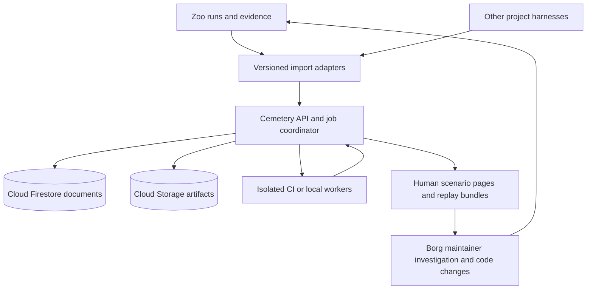

# Architecture proposal: a shared laboratory for Borg battle scenarios

Status: **proposed for architecture review; no implementation authorized by this
document**. This revision incorporates the owner's clarification: cemetery studies
battle scenarios and how Borgs survive or die. Borg-zoo owns population comparisons.
Configuration is recorded as evidence; parameter search is outside this design.
The earlier 64-case evaluation proposal is superseded.

## Owner decision: Cemetery execution and storage, Zoo reports (2026-11-16)

Design the shared database and artifact contract in **Cemetery first**, then
add the saved-scenario execution mode tracked in
[Cemetery #32](https://github.com/diegoami/borg-cemetery/issues/32).
Cemetery owns saves, scenarios, run/continuation records, intermediate
checkpoints and canonical evidence. **Zoo owns aggregation, comparison reports
and report presentation**, consuming immutable Cemetery result snapshots.
This allocation supersedes earlier ownership suggestions in this proposal,
including the historical human-report allocation in the original architecture
review packet. The Firebase documents below remain a backend proposal, not
a deployed service or an accepted milestone.

| Execution mode | Game execution | Authoritative saves and run evidence | Reports |
| --- | --- | --- | --- |
| Zoo executes pinned Cemetery inputs | Zoo workers | Cemetery | Zoo |
| Cemetery executes saved scenarios | Cemetery CLI or optional Cemetery CI | Cemetery | Zoo |

Both modes share scenario, runtime, configuration, life, segment, checkpoint
and attempt identities, plus a versioned result/export contract. Zoo must be
able to report an already completed Cemetery batch without rerunning it.
Record every requested cell and its executor, including incomplete and failed
attempts; worker location does not change outcome or independence semantics.

Save bytes belong in one durable content-addressed artifact store, referenced
by the database. Each execution loads a private copy and appends new
checkpoints; it never overwrites its input. Publish a checkpoint as usable only
after all required engine/Borg-state blobs are durable and verified. Zoo and
Cemetery retention references protect the same blobs. Keep explicit fresh-Borg
restart versus verified uninterrupted-continuation labels.

[Zoo #114](https://github.com/diegoami/borg-zoo/issues/114) remains the joint
architecture coordination issue; its vendor evaluation feeds Cemetery's
database decision. [Zoo #144](https://github.com/diegoami/borg-zoo/issues/144)
covers both executor modes and reporting integration.
[Cemetery #31](https://github.com/diegoami/borg-cemetery/issues/31) covers living
100k milestones and continuation. Database design comes before executor/API
integration: schema, immutable result snapshots, ingestion/retry/concurrent
claims, durable publication, retention and backup/export must fit both modes.
Provider and deployment choices remain open; no database service is deployed.

Read the [scenario and integration contract](architecture/scenario-contract.md)
for identities, state transitions, adapter operations and acceptance examples.
The [Firebase backend decision](architecture/firebase-backend.md) specifies the
managed document/artifact backend, queries, authorization and recovery protocol.
The [review response](architecture/review-response.md) tracks the six findings
on the previous proposal head and the corrections proposed here.
The [review prompt](architecture/review-prompt.md) defines this review. M1 remains
unaccepted and its implementation boundary is unchanged.

## 1. Purpose and ownership

The questions are: what happened in this encounter, what did the Borg know, why
did it die or recover, and can another implementation survive the same position?
Study surviving battles as well as deaths. Preserve executable situations with
their context, and stop spending analysis effort on an old failure once it no
longer affects a project's tracked build. A useful outcome is an explanation,
reproduction and focused regression case for the Borg maintainer.

| Owner | Responsibility |
| --- | --- |
| Borg-zoo | Seed suites, population experiments, aggregation/comparison reports and presentation, performance statistics and any confirmation/sealed-suite policy |
| Cemetery | Shared save/run database and artifacts, encounter discovery, death/near-death qualification, scenario packages, reconstruction, local or CI trials and current-build relevance evidence |
| Borg/engine project | Gameplay, instrumentation, configuration export, native build/run/save support and any private-state transfer contract |
| Project maintainer | Tracked builds/configurations, investigation priorities, proposed gameplay changes and acceptance |

Cemetery does not own an optimizer, population scoreboard or population experiment
scheduler.
It does not sweep parameters, select a winning profile or assert population
survival gains from its selected scenarios. Configuration variants describe what
was played. An explicitly requested alternative build/configuration may be tried
on a scenario, but it is an investigative trial, not an automatic tuning loop.
Broader validation of a gameplay change belongs in zoo.

This boundary follows the inspected
[zoo design at 912ecb13](https://github.com/diegoami/borg-zoo/blob/912ecb13bb08e99f6d57b381a10b794e22e3423c/docs/DESIGN.md).
It is an integration proposal, not a claim that zoo already exports cemetery
scenario packages or that either repository has been changed to do so.

## 2. Discover over thousands of fixed starting cases

Select a frozen manifest of **many thousands of discovery cases**, initially
targeting **8,192 cases per project** across approved source suites. This is an
operational starting target for encounter diversity, not a statistical power
claim or a hard ceiling. Support larger catalogues and deep-game sources; report
coverage by character, depth and encounter mechanism. Tens of cases are suitable
only for testing the pipeline. Thousands of town deaths still provide little
coverage of a late-game battle.

Reuse zoo's eligible development/discovery suites and their exact birth rules,
caps and seed identities. Where additional cases are needed, their source owner
registers another frozen discovery manifest. Do not silently modify suites,
reinterpret a seed under another engine, or open confirmation/sealed inputs for
exploratory analysis. The 8,192-case catalogue does not exist yet; no seeds are
generated or suites unsealed by this PR. A project without zoo can supply the
same versioned manifest through a native importer.

This catalogue is a source index, not a requirement to rerun every case in
cemetery for every build. Import qualified zoo results first. Request additional
captures only for missing encounter evidence, scenario creation or relevance
checks. Imported original runs and diagnostic reruns have different attempt IDs;
never replace a measured zoo run with a cemetery rerun.

Keep a few tracked builds per project, initially reference/current/previous,
with explicit effective configurations. A thousand indexed outcomes can be
cheap while only a small subset has detailed traces or active investigations.
The detailed scenario-bank quota is independent of discovery catalogue size.

## 3. Components and deployment

Propose **Firebase Cloud Firestore** for metadata, **Cloud Storage for Firebase**
for compressed artifacts, and **Firebase Authentication** for user identity.
Firestore's document/collection model and compound queries fit the source,
scenario, evidence and study records. Use Firestore rather than Firebase Realtime
Database's single JSON tree.
([Database comparison](https://firebase.google.com/docs/firestore/rtdb-vs-firestore).)

Host human pages on Firebase Hosting with a small Cloud Run API/coordinator.
Workers stay in GitHub Actions or run locally; native games and heavy analysis
do not execute inside database callbacks. All authoritative mutations go through
the coordinator, which implements identity uniqueness and referential invariants
with deterministic document keys, transactions and explicit validation. These
are application obligations; no SQL foreign-key guarantee is assumed.

Local development uses the Firebase Auth/Firestore/Storage emulators and a local
API, while downloaded native scenario bundles remain usable offline. An emulator
is a development/test dependency, not a self-hosted production Firebase service.
Other maintainers can use a shared workspace or deploy into their own Firebase
project; identifiers and source packages are not tied to this owner's account.
No Kubernetes, separate broker, search cluster or AI provider is required.
Deployment, billing, indexes and rules need qualification before cutover; no
Firebase resource is provisioned by this design update.

## 4. Identity and stored records

| Record | Stable identity and purpose |
| --- | --- |
| Workspace/project | Owner namespace, permissions, adapter and engine family; supports independent users/installations |
| Source case | Source catalogue revision, seed and complete birth/initialization contract |
| Build/configuration | Immutable source/runtime/data identity plus resolved effective settings; display labels can point to newer identities |
| Run attempt | Original source run identity or separate diagnostic execution, actual outcome, provenance and available evidence |
| Episode | Observed encounter sequence within one attempt: boundaries, context, outcome and danger qualification |
| Scenario revision | Immutable runnable start and observation/encounter contract derived from an episode |
| Evidence check | Immutable executed seed/local check with its own execution contract, terminal outcome, encounter result and observation scope |
| Study/assessment | Independent study objective; per-study/build/configuration relevance projection over shared checks and a hazard qualification contract when applicable |
| Investigation/trial | Exact evidence and tool versions, target scenario/build, hypothesis, executed alternative and qualified outcome |
| Artifact/pin/job | Digests, locations, dependency owners, retention state, worker leases and deletion receipts |

A seed is essential provenance but is not a globally unique scenario. The same
seed can contain several battles; different engines give it different meaning.
One encounter may have several checkpoints. A source execution is identified by
producer/repository, immutable origin result revision/path, suite/cell and source
execution/attempt coordinates, within a workspace/project. A later retrieval
commit is provenance, not a new execution identity. Repeated measured executions
have distinct source coordinates even when their logical cell is identical.
Merge identical reimports by that qualified key and payload digest; group related
encounters for browsing without merging original lives or replacing evidence.

Build identity includes repository, resolved commit, source-input digest,
clean/dirty status, executable/runtime/data digest, compiler/build flags and
instrumentation versions. Configuration records requested overrides **and all
effective defaults**, selected core, native options and relevant environment.
Retain source bytes for dirty inputs or label reconstruction unavailable.
Unknown settings stay unknown; they cannot support a controlled equivalence claim.

Every observation identifies engine tick, player decision and engine event where
available. Keep counters distinct. Outcome labels include death, recovery,
ongoing encounter, alive at horizon, win, stall, policy stop, timeout, failure and
identity/configuration mismatch. A living final sample is not proven recovery.

## 5. Encounters, deaths and genuine near-deaths

An episode starts at the last supported reasonably stable state before tactical
interaction and follows deterioration, engagement, escape, death or recovery.
Extend it backwards when a preparation decision or resource shortage explains
the battle. There is no fixed preceding 10/20/30-turn rule. Record the inferred
boundary, its uncertainty and the actual earlier checkpoint used for replay.

Keep **outcome** separate from **danger qualification**. A routine battle that
the Borg survives is useful evidence and a control, without being a near-death.
Candidates include real deaths, independently detected damage/exposure, Borg
alarms and representative ordinary encounters. Borg fear or low HP alone never
qualifies a near-death.

The initial near-death qualifier verifies a credible lethal exposure from
engine mechanics: hostile actions/residual effects due before the next legal
player decision, actual speed/energy ordering, attack eligibility, hit/damage
distributions, resistances and status effects. A theoretical maximum-damage roll
alone is insufficient. Require a calibrated nontrivial lethal probability and
then observed sustained recovery. Unsupported or incomplete mechanics produce
an unverified candidate, not a fabricated risk score. Other hazard families
need their own reviewed qualifier; strategic starvation is not automatically a
battle near-death.

Calibration uses reviewed positive and negative fixtures, including safe low HP,
fear without an attack opportunity, fast multiple attacks and high-HP lethal
bursts. Sample non-triggered surviving fights to find misses. Version the
qualifier and boundary/recovery rules; threshold values remain pilot findings.
Hazard studies depend on an immutable qualification contract covering evaluator,
thresholds, scheduling and recovery semantics. Updating it makes affected hazard
projections pending requalification, preserving previous-version results. A
changed diagnostic qualifier alone does not rewrite a runnable scenario; changing
its start, encounter anchor or replay endpoint requires a new scenario revision.
Engine truth is diagnostic evidence and must be separated from what the Borg
could observe. Investigations can explain unknown threats without giving tested
Borgs access to hidden game information.

## 6. Capture and reconstruct executable situations

Import a source's actual evidence inventory and verify retrieved bytes before
claiming durable capture. Zoo's inspected
[evidence inventory](https://github.com/diegoami/borg-zoo/blob/912ecb13bb08e99f6d57b381a10b794e22e3423c/zoo/evidence.py)
describes file hashes and missing files; it is not replay qualification. Its
[borg-rs adapter](https://github.com/diegoami/borg-zoo/blob/912ecb13bb08e99f6d57b381a10b794e22e3423c/zoo/borgrs.py)
has an evidence-retention mode; without it some non-death streams are discarded.
Do not assume surviving battles or private Borg state were recorded historically.
An opt-in producer export/retention hook is future integration work.

During an instrumented run, use periodic checkpoints, a bounded recent trace
buffer and a compact complete replay recipe/input stream. Triggers preserve
checkpoint/context chunks, including surviving encounters, before buffer expiry.
Generate a scenario package containing verified save bytes, engine RNG, runtime
and data dependencies, effective settings, knowledge/inventory observations,
encounter anchors, outcome/recovery criteria and replay instructions. Original
evidence remains immutable when a report or scenario definition is revised.

Two modes must remain explicit:

- **Shared engine save, fresh Borg state:** baseline and alternative load the
  same save/RNG with equally reset Borg state. Useful for position studies and
  supported by the current runner; not the original uninterrupted decision.
- **Original-prefix continuation:** compatible private-state restoration or a
  verified prefix replay to a supported intervention/state-transfer boundary.
  This stronger capability is adapter-specific and not yet implemented here.

Reconstruction requires the exact runtime/data/configuration and all relevant
birth/time/random inputs, plus checkpoints/input streams where needed. A seed
alone is insufficient. Qualify it by matching intermediate world/input digests,
scenario anchor and outcome; reject divergence. Rebuilding from source is a
fallback whose bytes/behavior must be verified. Save compatibility and Borg-state
compatibility are distinct gates. Failure to load or a silently new character
cannot count as surviving a scenario.

## 7. Revalidate relevance before spending analysis effort

A scenario revision preserves its original position and outcome. A new build
creates new study-specific assessments, not a rewritten death account. Assessment
identity includes the immutable **study revision**, target build and effective
configuration, plus the qualification contract for hazard studies. Death,
hazardous-recovery, ordinary-battle and pinned local-tactical objectives have
independent priorities while sharing immutable execution evidence. Another
user's result cannot silently resolve them globally.

When a tracked build changes, import any equivalent source result first, then
queue missing relevance checks for the project's active investigations. Keep
bounded episode-follow-up checks separate from full-seed results: surviving a
seed means a verified living endpoint at its complete original source horizon,
or an engine-confirmed win, under the same birth/ordinary-play contract. Local
follow-up extends past the old episode through its declared recovery window.
Record terminal outcome, encounter result, scope, death relation and contract
validity as independent fields. Thus verified full-horizon survival with unknown
encounter details is representable and can deactivate only the death study.
Explicitly check whether the encounter occurred where evidence permits. A short
run, stall, failed reconstruction or mismatched contract cannot establish seed
survival. Prioritize active cases; do not launch a duplicate whole-population
experiment.

| New evidence | Investigation action |
| --- | --- |
| Same encounter still kills in a full-seed check | Keep its death study active; a later matched seed death can reopen that objective |
| Same encounter produces a qualified near-death and recovers | Hazard study active; death study may be inactive at the same time |
| Same encounter is survived with verified recovery | Deactivate that death study for the build/configuration; independent hazard/ordinary studies keep their own priorities |
| Full seed survives its source horizon; encounter avoided or unknown | Stop the old death investigation for this build/configuration; preserve the avoided/unknown distinction and make no direct battle-survival claim |
| Shorter continuation passes the old episode without encountering it | Record bounded non-recurrence and provisionally lower priority; no full-seed survival claim |
| Seed survives, but the old saved-position trial still fails | Record both; seed-death manifestation inactive, while local danger remains reproducible under its declared continuation mode |
| Old position is survived, but the seed dies later | Mark local survival; create/link the later failure as a different episode |
| Terminal/contract evidence is missing, or the check fails/ends too early | Keep pending/unverified; missing encounter details alone are independent of a verified full-seed survival receipt |

Full-seed results and saved-position trials are separate assessment fields. Even
when a new build unexpectedly survives a seed, do not infer which change caused
it. Stop pursuing the now-inactive manifestation by default; a maintainer may
explicitly pin the old position as a tactical study. A later build that fails it
again reopens the applicable study and links the regression only under that
objective's compatible evidence contract. A local-only death reopens a pinned
local-tactical study, not a seed-death investigation when the seed still survives.
Repeated seed avoidance plus local death therefore does not create a new
seed-death regression. Qualifier changes trigger requalification, not a claimed
Borg regression. Detailed transitions are in the scenario contract.

Seed-survival deactivation applies to the old **death manifestation**. A study
of a near-death or an ordinary surviving battle is not dismissed merely because
its source run remains alive; assess its encounter/hazard evidence or the
maintainer's explicit study objective. A recovered but still hazardous encounter
may remain active as a near-death study after its death investigation is inactive.

Before dispatching a deep analysis, check assessment freshness against the
currently tracked immutable build and configuration. Leases pin its evidence.
If a newer build arrives while it runs, keep the result labelled for its old
target and revalidate before presenting it as a current problem. Missing new
evidence sets freshness to pending; it does not establish a fix.

## 8. Analysis and the human interface

Query by project, build/configuration, seed, encounter family, outcome or current
relevance. The job joins observations, messages, available thoughts, inventory,
spells and actions into a readable chronology. It distinguishes observed facts,
Borg beliefs, diagnostic hidden facts and analyst hypotheses. Look broadly for
behavioral or implementation explanations, without a fixed checklist of tactics.

Each retained scenario has a stable landing page: exact seed/build/settings,
start/episode/end timeline, cause or recovery, replay availability, original and
alternative results, inventory/spells, and genuine screenshot animation where
qualified capture allows it. Reports/GIFs are generated and cached on demand;
serialized machine documents are never the required human interface. Downloaded
bundles generate build/watch/play launchers and use verified per-version caches.
Human play is an explicitly labelled alternative attached to the same scenario.

Deliver a feedback packet with the reproducible situation, what the Borg knew,
supported mechanism, competing explanations, earliest useful intervention point,
proposed code/behavior/instrumentation change and focused scenario checks.
Alternative trials report survival, new death, avoidance, recovery, progress and
uncertainty. Local success does not establish a population improvement. The Borg
maintainer implements/reviews changes and asks zoo for broad validation as needed.
The analyzer does not mutate parameters, open upstream issues or publish changes
without a separately authorized action.

## 9. Reuse by other projects and users

Publish a versioned adapter and portable scenario-bundle contract, with capability
levels for metadata, chronology, reconstruction, shared-save trials and private
continuation. Start with borg-rs and borg-reborn-rs adapters, but require no
sibling checkout, owner-specific repository name, fixed filesystem path or CI
provider. Native C and Neo projects can add adapters; sharing record syntax does
not make their seeds, clocks, observations or save formats interchangeable.

Each workspace owns project namespaces, tracked builds, priorities, quotas and
sharing policy. Default evidence is private to that workspace. Explicit exports
produce portable, checksummed bundles; importing one preserves origin and gives
it a local assessment. Sharing a public fixture requires retaining its complete
declared replay dependencies. Metadata-only imports remain usable for browsing
but are not advertised as runnable.

Enforce workspace permissions on queries, jobs, artifacts and downloads. Initially
deduplicate objects only inside one workspace; no cross-user hash/availability
leak or permission inheritance. Trusted publication receives job-scoped upload
access; candidate code receives no database/deletion credentials. Offline bundle
inspection/import must not execute included launchers. Execution is an explicit
isolated worker action. Check archive paths, declared sizes and digests before
extracting untrusted bundles. Native bundles run offline; local service development
uses emulators. Production self-hosting of the managed backend is not promised.

## 10. Bounded storage and reliable jobs

Keep compact source/run/scenario documents in the database; compress and chunk
large observations/thoughts/input streams in external storage. Git holds tools,
schemas, source-manifest references and small selected fixture manifests. No new
routine report archive or statistical data dump is added to Git under this model.

Initial per-workspace budget proposal: three active builds, **20 GiB of artifact
storage**, and **100 promoted detailed scenarios**, separate from thousands of
indexed discovery cases. These are pilot limits to measure, configurable by the
workspace owner, not global limits imposed on other users. Count artifact
versions/backups and pinned runtimes; expiry dates alone do not bound storage.

| Evidence | Initial retention proposal |
| --- | --- |
| Raw traces and disposable checkpoints | Seven-day capture/investigation window; promote selected episodes before expiry |
| Reports, GIFs and screenshots | Regenerable cache, initially seven days; discard first under pressure |
| Active source recipes and selected scenarios | Keep dependencies needed for their advertised reconstruction/replay level |
| Inactive, unpinned detailed evidence | Thirty-day grace period, then collect; keep a compact result while metadata is retained |
| Retired run detail/assessments | Initially 180 days unless a bounded investigation/regression pin requires them |

Resolved/avoided scenarios release investigation pins after a cooldown unless
selected for the bounded regression bank. Keep diverse failures, recoveries and
ordinary controls, not only spectacular early deaths. Similar reports can share
one representative detailed fixture without erasing distinct run identities.

Pins transitively protect replay dependencies. Live jobs hold temporary leases;
expired leases require a grace period before collection. Garbage collection
plans affected owners, marks objects, waits, then serializes its final reference
check/delete transition with new pin acquisition. Verify imported bytes before
releasing source dependencies. Record unavailable/pruned status and a bounded
deletion receipt. A valid hash without recoverable bytes is not replay evidence.
Firestore TTL and bucket expiry apply only to independently disposable records
and objects, not authoritative studies, pins or shared runtime dependencies.
Firestore TTL is asynchronous and does not cascade into subcollections; the
coordinator owns dependency-aware retirement and bounded deletion.
([Firestore TTL](https://firebase.google.com/docs/firestore/ttl).)

When protected data fills the quota, pause new admissions and expose the required
retirement decision. Budget database detail, job receipts and backups separately;
use bounded snapshots rather than an infinite history of every assessment.
After metadata expires, the landing route explains that the case is unavailable.
Recovery snapshots include core metadata plus a verified manifest of required
immutable Cloud Storage generations, retained for the snapshot's entire lifetime.
Pause workspace writes/GC while creating that bounded recovery set. Independent
database and bucket backups are not a coordinated recovery point. After restore,
fence old jobs with a new deployment epoch and reconcile actual object bytes
before advertising replay or dispatching work. Missing dependencies become
unavailable/incomplete. The Firebase decision specifies the cross-store protocol.

Ingestion registers expected captures before execution. Immutable objects are
uploaded and hash-verified before transactionally attaching a complete manifest.
Transactional creation of deterministic identity documents prevents duplicate
imports; an altered payload under an existing qualified source key is a conflict.
Attempts and jobs have idempotency keys, leases and fencing tokens, so late
workers cannot overwrite new results. Incomplete
uploads remain explicitly incomplete and orphan objects expire after a grace
period. No failure or missing cell becomes a death or survival.

## 11. Migration and review gates

Retain the current seven cases, human recordings, published downloads and M1
review evidence as migration pins. No evidence is deleted, history rewritten,
service deployed or other repository modified by this proposal.

Reuse native exporters, seed/build receipts, candidate episode extraction,
shared-save runner, recorder/cache and readable-page generators. Add storage and
adapter boundaries rather than copying harness logic. Replace the current
same-source-only batch comparator only where a local scenario comparison needs
cross-build compatibility; leave population comparisons to zoo. Retire routine
results-branch publication after the replacement path is verified.

Proposed delivery slices, subject to architecture/milestone approval:

1. **Imports and portable identity:** ingest pinned zoo and native examples,
   including survivors, with settings/evidence gaps visible. Prove idempotence,
   namespace isolation and thousands-of-cases indexing without new Git data.
2. **Executable episodes:** retain adaptive battle sequences, calibrate the
   independent near-death qualifier, package saves/runtimes and verify replay.
   Prove safe-low-HP/fear-only negatives and real lethal-exposure positives.
3. **Current-build relevance:** implement the assessment table above and job
   freshness. Prove unexpected seed survival deprioritizes an old failure,
   avoidance is distinguished, later death creates a new case and regression
   reopens the correct study without rewriting old evidence. Prove simultaneous
   death-inactive/hazard-active state and qualifier-change requalification.
4. **Shared investigation service:** on-demand readable pages, human/alternative
   trials and maintainer packets. A second project imports and runs a supported
   package without the original author's checkout or account.
5. **Bounded cutover:** fault-inject collection/pinning races, exercise quotas,
   reproduce a case after discarding its generated report, and restore from a
   recovery snapshot taken before a later artifact collection. Reject stale
   worker epochs and reconcile missing bytes before serving availability. Test
   Firestore authorization, indexes and transaction/pin races in emulators and
   a bounded staging deployment before routine Git publication stops.

Review must settle the source discovery manifests, adapter instrumentation gaps,
near-death calibration method, recovery/encounter predicates, configuration
visibility, Firebase deployment details and workspace quotas. The requested
decision is architecture direction and changes before implementation planning,
not milestone acceptance or permission to start running a new platform.
