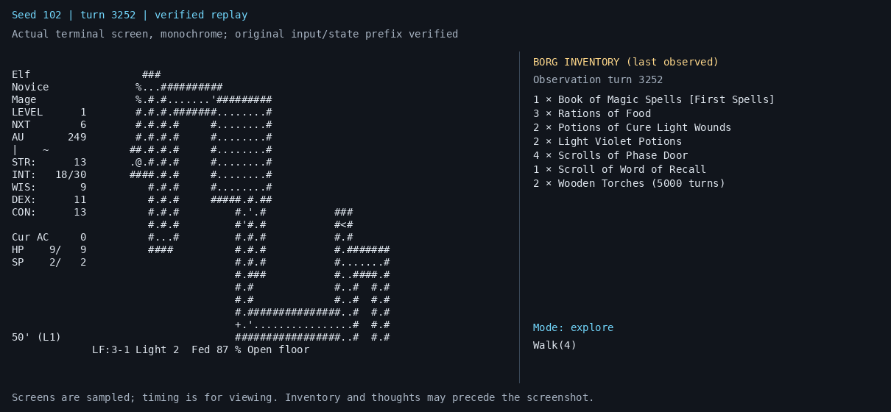

# near_death_candidate: observed sequence

Boundary: stable_observation; start turn 3252; endpoint 3262; resolution recovered_to_stable.

The start is inferred from sustained HP and available Borg threat estimates, not proof of safety. Missing threat, inventory or perception evidence stays unknown. Follow earlier causes beyond this boundary when needed.

Save scenario: ready_for_restart_trials; startup: fresh Borg, saved engine RNG. Alternative Borgs share a game state; original Borg memory is not restored.

Retained save turn: 3202; inferred stable boundary: 3252.

At the saved/report starting point (turn 3202), the character had 9/9 HP at depth 1. The lowest logged HP was 9/9 at turn 3202. Observed Borg mode sequence: explore → engage.

Chronology is ordered by engine turn. Cross-stream ordering at the same turn is unresolved. Full observations are in sequence.json.

| Turn | Evidence | Observation |
| --- | --- | --- |
| 3202 | state.log:723 | HP 9/9; SP 2/2; depth 1; position 112,2 |
| 3202 | trace.jsonl:331 | Borg mode explore; goal reveal the frontier; choice Walk(2); threat {'horizon': 1, 'expected': 0.0, 'worst': 0.0, 'p_death': 0.0, 'disabling': 0.0, 'summoning': 0.0, 'economic': 0.0} |
| 3212 | trace.jsonl:332 | Borg mode explore; goal reveal the frontier; choice Walk(2); threat {'horizon': 1, 'expected': 0.0, 'worst': 0.0, 'p_death': 0.0, 'disabling': 0.0, 'summoning': 0.0, 'economic': 0.0} |
| 3222 | trace.jsonl:333 | Borg mode explore; goal reveal the frontier; choice Walk(2); threat {'horizon': 1, 'expected': 0.0, 'worst': 0.0, 'p_death': 0.0, 'disabling': 0.0, 'summoning': 0.0, 'economic': 0.0} |
| 3232 | trace.jsonl:334 | Borg mode explore; goal reveal the frontier; choice Walk(2); threat {'horizon': 1, 'expected': 0.0, 'worst': 0.0, 'p_death': 0.0, 'disabling': 0.0, 'summoning': 0.0, 'economic': 0.0} |
| 3242 | trace.jsonl:335 | Borg mode explore; goal reveal the frontier; choice Walk(1); threat {'horizon': 1, 'expected': 0.0, 'worst': 0.0, 'p_death': 0.0, 'disabling': 0.0, 'summoning': 0.0, 'economic': 0.0} |
| 3252 | trace.jsonl:336 | Borg mode explore; goal reveal the frontier; choice Walk(4); threat {'horizon': 1, 'expected': 0.0, 'worst': 0.0, 'p_death': 0.0, 'disabling': 0.0, 'summoning': 0.0, 'economic': 0.0} |
| 3262 | trace.jsonl:337 | Borg mode explore; goal reveal the frontier; choice Walk(6); threat {'horizon': 1, 'expected': 5.4624999999999995, 'worst': 9.2, 'p_death': 0.0, 'disabling': 0.0, 'summoning': 0.0, 'economic': 2.1849999999999996, 'sources': [{'index': 45, 'race': 53, 'name': 'Sméagol', 'dist': 2, 'speed': 130, 'awake': True, 'in_view': True, 'confused': False, 'stunned': False, 'group': 1, 'confidence': 1.0, 'rounds': 2.3, 'expected': 5.4624999999999995, 'worst': 9.2, 'disabling': 0.0, 'ranged': False}]} |
| 3272 | messages.log:60 | You have 3 Scrolls of Phase Door (e). |
| 3272 | trace.jsonl:338 | Borg mode engage; goal win the exchange; choice Read { item: 4 }; threat {'horizon': 1, 'expected': 7.8374999999999995, 'worst': 13.2, 'p_death': 0.2679296875, 'disabling': 0.0, 'summoning': 0.0, 'economic': 3.135, 'sources': [{'index': 45, 'race': 53, 'name': 'Sméagol', 'dist': 1, 'speed': 130, 'awake': True, 'in_view': True, 'confused': False, 'stunned': False, 'group': 1, 'confidence': 1.0, 'rounds': 3.3, 'expected': 7.8374999999999995, 'worst': 13.2, 'disabling': 0.0, 'ranged': False}]} |
| 3282 | trace.jsonl:339 | Borg mode engage; goal win the exchange; choice Walk(3); threat {'horizon': 1, 'expected': 0.0, 'worst': 0.0, 'p_death': 0.0, 'disabling': 0.0, 'summoning': 0.0, 'economic': 0.0} |
| 3292 | trace.jsonl:340 | Borg mode engage; goal win the exchange; choice Walk(1); threat {'horizon': 1, 'expected': 0.0, 'worst': 0.0, 'p_death': 0.0, 'disabling': 0.0, 'summoning': 0.0, 'economic': 0.0} |
| 3302 | trace.jsonl:341 | Borg mode engage; goal win the exchange; choice Walk(3); threat {'horizon': 1, 'expected': 0.0, 'worst': 0.0, 'p_death': 0.0, 'disabling': 0.0, 'summoning': 0.0, 'economic': 0.0} |

Terminal observation: recovered_to_stable.

Investigate any evidence-backed survival improvement. Separate facts, hypotheses and missing observations; propose a mechanism, intervention, prediction and experiment. No predefined behavior checklist limits the investigation.

[Inventory, equipment and spells](inventory.md): available.

Animation capture: complete; provenance in media/media.json.
