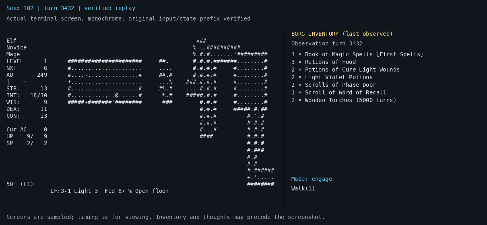

# death: observed sequence

Boundary: stable_observation; start turn 3432; endpoint 3640; resolution death.

The start is inferred from sustained HP and available Borg threat estimates, not proof of safety. Missing threat, inventory or perception evidence stays unknown. Follow earlier causes beyond this boundary when needed.

Save scenario: ready_for_restart_trials; startup: fresh Borg, saved engine RNG. Alternative Borgs share a game state; original Borg memory is not restored.

Retained save turn: 3402; inferred stable boundary: 3432.

At the saved/report starting point (turn 3402), the character had 9/9 HP at depth 1. The lowest logged HP was -2/9 at turn 3640. Observed Borg mode sequence: engage → recover → engage → recover → engage.

Chronology is ordered by engine turn. Cross-stream ordering at the same turn is unresolved. Full observations are in sequence.json.

| Turn | Evidence | Observation |
| --- | --- | --- |
| 3402 | messages.log:63 | You failed to pick the lock. |
| 3402 | state.log:765 | HP 9/9; SP 2/2; depth 1; position 88,8 |
| 3402 | trace.jsonl:351 | Borg mode engage; goal win the exchange; choice Walk(1); threat {'horizon': 1, 'expected': 0.0, 'worst': 0.0, 'p_death': 0.0, 'disabling': 0.0, 'summoning': 0.0, 'economic': 0.0} |
| 3412 | messages.log:64 | You failed to pick the lock. |
| 3420 | messages.log:65 | You hear a door burst open! |
| 3422 | messages.log:66 | You have picked the lock. |
| 3422 | trace.jsonl:352 | Borg mode engage; goal win the exchange; choice Walk(1); threat {'horizon': 1, 'expected': 0.0, 'worst': 0.0, 'p_death': 0.0, 'disabling': 0.0, 'summoning': 0.0, 'economic': 0.0} |
| 3432 | trace.jsonl:353 | Borg mode engage; goal win the exchange; choice Walk(1); threat {'horizon': 1, 'expected': 0.0, 'worst': 0.0, 'p_death': 0.0, 'disabling': 0.0, 'summoning': 0.0, 'economic': 0.0} |
| 3440 | messages.log:67 | Fang, Farmer Maggot's Dog, bites you. |
| 3442 | messages.log:68 | You have a Scroll of Phase Door (e). |
| 3442 | state.log:772 | HP 5/9; SP 2/2; depth 1; position 87,9 |
| 3442 | trace.jsonl:354 | Borg mode engage; goal win the exchange; choice Read { item: 4 }; threat {'horizon': 1, 'expected': 5.4624999999999995, 'worst': 9.2, 'p_death': 0.5640625, 'disabling': 0.0, 'summoning': 0.0, 'economic': 0.0, 'sources': [{'index': 16, 'race': 48, 'name': "Fang, Farmer Maggot's Dog", 'dist': 1, 'speed': 120, 'awake': True, 'in_view': True, 'confused': False, 'stunned': False, 'group': 1, 'confidence': 1.0, 'rounds': 2.3, 'expected': 5.4624999999999995, 'worst': 9.2, 'disabling': 0.0, 'ranged': False}]} |
| 3452 | trace.jsonl:355 | Borg mode recover; goal rest to full; choice Rest(75); threat {'horizon': 1, 'expected': 0.0, 'worst': 0.0, 'p_death': 0.0, 'disabling': 0.0, 'summoning': 0.0, 'economic': 0.0} |
| 3462 | trace.jsonl:356 | Borg mode recover; goal rest to full; choice Rest(75); threat {'horizon': 1, 'expected': 0.0, 'worst': 0.0, 'p_death': 0.0, 'disabling': 0.0, 'summoning': 0.0, 'economic': 0.0} |
| 3472 | trace.jsonl:357 | Borg mode recover; goal rest to full; choice Rest(75); threat {'horizon': 1, 'expected': 0.0, 'worst': 0.0, 'p_death': 0.0, 'disabling': 0.0, 'summoning': 0.0, 'economic': 0.0} |
| 3482 | trace.jsonl:358 | Borg mode recover; goal rest to full; choice Rest(75); threat {'horizon': 1, 'expected': 0.0, 'worst': 0.0, 'p_death': 0.0, 'disabling': 0.0, 'summoning': 0.0, 'economic': 0.0} |
| 3492 | trace.jsonl:359 | Borg mode recover; goal rest to full; choice Rest(75); threat {'horizon': 1, 'expected': 0.0, 'worst': 0.0, 'p_death': 0.0, 'disabling': 0.0, 'summoning': 0.0, 'economic': 0.0} |
| 3502 | trace.jsonl:360 | Borg mode recover; goal rest to full; choice Walk(4); threat {'horizon': 1, 'expected': 3.0874999999999995, 'worst': 5.199999999999999, 'p_death': 0.0, 'disabling': 0.0, 'summoning': 0.0, 'economic': 0.0, 'sources': [{'index': 16, 'race': 48, 'name': "Fang, Farmer Maggot's Dog", 'dist': 2, 'speed': 120, 'awake': True, 'in_view': True, 'confused': False, 'stunned': False, 'group': 1, 'confidence': 1.0, 'rounds': 1.2999999999999998, 'expected': 3.0874999999999995, 'worst': 5.199999999999999, 'disabling': 0.0, 'ranged': False}]} |
| 3512 | trace.jsonl:361 | Borg mode recover; goal rest to full; choice Walk(6); threat {'horizon': 1, 'expected': 3.0874999999999995, 'worst': 5.199999999999999, 'p_death': 0.0, 'disabling': 0.0, 'summoning': 0.0, 'economic': 0.0, 'sources': [{'index': 16, 'race': 48, 'name': "Fang, Farmer Maggot's Dog", 'dist': 2, 'speed': 120, 'awake': True, 'in_view': True, 'confused': False, 'stunned': False, 'group': 1, 'confidence': 1.0, 'rounds': 1.2999999999999998, 'expected': 3.0874999999999995, 'worst': 5.199999999999999, 'disabling': 0.0, 'ranged': False}]} |
| 3522 | trace.jsonl:362 | Borg mode recover; goal rest to full; choice Walk(4); threat {'horizon': 1, 'expected': 3.0874999999999995, 'worst': 5.199999999999999, 'p_death': 0.0, 'disabling': 0.0, 'summoning': 0.0, 'economic': 0.0, 'sources': [{'index': 16, 'race': 48, 'name': "Fang, Farmer Maggot's Dog", 'dist': 2, 'speed': 120, 'awake': True, 'in_view': True, 'confused': False, 'stunned': False, 'group': 1, 'confidence': 1.0, 'rounds': 1.2999999999999998, 'expected': 3.0874999999999995, 'worst': 5.199999999999999, 'disabling': 0.0, 'ranged': False}]} |
| 3532 | messages.log:69 | You have no more Scrolls of Phase Door (e). |
| 3532 | trace.jsonl:363 | Borg mode engage; goal win the exchange; choice Read { item: 4 }; threat {'horizon': 1, 'expected': 5.4624999999999995, 'worst': 9.2, 'p_death': 0.5640625, 'disabling': 0.0, 'summoning': 0.0, 'economic': 0.0, 'sources': [{'index': 16, 'race': 48, 'name': "Fang, Farmer Maggot's Dog", 'dist': 1, 'speed': 120, 'awake': True, 'in_view': True, 'confused': False, 'stunned': False, 'group': 1, 'confidence': 1.0, 'rounds': 2.3, 'expected': 5.4624999999999995, 'worst': 9.2, 'disabling': 0.0, 'ranged': False}]} |
| 3542 | trace.jsonl:364 | Borg mode recover; goal rest to full; choice Rest(75); threat {'horizon': 1, 'expected': 0.0, 'worst': 0.0, 'p_death': 0.0, 'disabling': 0.0, 'summoning': 0.0, 'economic': 0.0} |
| 3552 | trace.jsonl:365 | Borg mode recover; goal rest to full; choice Rest(75); threat {'horizon': 1, 'expected': 0.0, 'worst': 0.0, 'p_death': 0.0, 'disabling': 0.0, 'summoning': 0.0, 'economic': 0.0} |
| 3562 | trace.jsonl:366 | Borg mode recover; goal rest to full; choice Rest(75); threat {'horizon': 1, 'expected': 0.0, 'worst': 0.0, 'p_death': 0.0, 'disabling': 0.0, 'summoning': 0.0, 'economic': 0.0} |
| 3572 | trace.jsonl:367 | Borg mode recover; goal rest to full; choice Rest(75); threat {'horizon': 1, 'expected': 0.0, 'worst': 0.0, 'p_death': 0.0, 'disabling': 0.0, 'summoning': 0.0, 'economic': 0.0} |
| 3582 | trace.jsonl:368 | Borg mode recover; goal rest to full; choice Rest(75); threat {'horizon': 1, 'expected': 0.0, 'worst': 0.0, 'p_death': 0.0, 'disabling': 0.0, 'summoning': 0.0, 'economic': 0.0} |
| 3592 | trace.jsonl:369 | Borg mode recover; goal rest to full; choice Rest(75); threat {'horizon': 1, 'expected': 0.0, 'worst': 0.0, 'p_death': 0.0, 'disabling': 0.0, 'summoning': 0.0, 'economic': 0.0} |
| 3602 | trace.jsonl:370 | Borg mode recover; goal rest to full; choice Rest(75); threat {'horizon': 1, 'expected': 0.7124999999999996, 'worst': 1.1999999999999993, 'p_death': 0.0, 'disabling': 0.0, 'summoning': 0.0, 'economic': 0.0, 'sources': [{'index': 16, 'race': 48, 'name': "Fang, Farmer Maggot's Dog", 'dist': 3, 'speed': 120, 'awake': True, 'in_view': True, 'confused': False, 'stunned': False, 'group': 1, 'confidence': 1.0, 'rounds': 0.2999999999999998, 'expected': 0.7124999999999996, 'worst': 1.1999999999999993, 'disabling': 0.0, 'ranged': False}]} |
| 3612 | messages.log:70 | Fang, Farmer Maggot's Dog, is targeted. |
| 3612 | messages.log:71 | Fang, Farmer Maggot's Dog, yelps in pain. |
| 3612 | state.log:844 | HP 6/9; SP 2/2; depth 1; position 84,6 |
| 3612 | trace.jsonl:371 | Borg mode engage; goal win the exchange; choice Cast { book: 0, letter: 97, aim: true }; threat {'horizon': 1, 'expected': 5.4624999999999995, 'worst': 9.2, 'p_death': 0.33843749999999995, 'disabling': 0.0, 'summoning': 0.0, 'economic': 0.0, 'sources': [{'index': 16, 'race': 48, 'name': "Fang, Farmer Maggot's Dog", 'dist': 1, 'speed': 120, 'awake': True, 'in_view': True, 'confused': False, 'stunned': False, 'group': 1, 'confidence': 1.0, 'rounds': 2.3, 'expected': 5.4624999999999995, 'worst': 9.2, 'disabling': 0.0, 'ranged': False}]} |
| 3615 | messages.log:72 | Fang, Farmer Maggot's Dog, bites you. |
| 3620 | messages.log:73 | Fang, Farmer Maggot's Dog, bites you. |
| 3620 | messages.log:74 | *** LOW HITPOINT WARNING! *** |
| 3622 | messages.log:75 | You feel much better. |
| 3622 | messages.log:76 | You have a Potion of Cure Light Wounds (c). |
| 3622 | state.log:849 | HP 0/9; SP 1/2; depth 1; position 84,6 |
| 3622 | trace.jsonl:372 | Borg mode engage; goal win the exchange; choice Quaff { item: 2 }; threat {'horizon': 1, 'expected': 5.4624999999999995, 'worst': 9.2, 'p_death': 0.9974999999999999, 'disabling': 0.0, 'summoning': 0.0, 'economic': 0.0, 'sources': [{'index': 16, 'race': 48, 'name': "Fang, Farmer Maggot's Dog", 'dist': 1, 'speed': 120, 'awake': True, 'in_view': True, 'confused': False, 'stunned': False, 'group': 1, 'confidence': 1.0, 'rounds': 2.3, 'expected': 5.4624999999999995, 'worst': 9.2, 'disabling': 0.0, 'ranged': False}]} |
| 3625 | messages.log:77 | Fang, Farmer Maggot's Dog, bites you. |
| 3630 | messages.log:78 | Fang, Farmer Maggot's Dog, bites you. |
| 3632 | messages.log:79 | Fang, Farmer Maggot's Dog, is targeted. |
| 3632 | messages.log:80 | You failed to concentrate hard enough! |
| 3632 | state.log:852 | HP 4/9; SP 1/2; depth 1; position 84,6 |
| 3632 | trace.jsonl:373 | Borg mode engage; goal win the exchange; choice Cast { book: 0, letter: 97, aim: true }; threat {'horizon': 1, 'expected': 5.4624999999999995, 'worst': 9.2, 'p_death': 0.7570312499999999, 'disabling': 0.0, 'summoning': 0.0, 'economic': 0.0, 'sources': [{'index': 16, 'race': 48, 'name': "Fang, Farmer Maggot's Dog", 'dist': 1, 'speed': 120, 'awake': True, 'in_view': True, 'confused': False, 'stunned': False, 'group': 1, 'confidence': 1.0, 'rounds': 2.3, 'expected': 5.4624999999999995, 'worst': 9.2, 'disabling': 0.0, 'ranged': False}]} |
| 3635 | messages.log:81 | Fang, Farmer Maggot's Dog, bites you. |
| 3640 | messages.log:82 | Fang, Farmer Maggot's Dog, bites you. |
| 3640 | messages.log:83 | You die. |
| 3640 | messages.log:84 | Score not registered for borgs. |
| 3640 | state.log:857 | HP -2/9; SP 0/2; depth 1; position 84,6 |

Terminal observation: Fang, Farmer Maggot's Dog.

Investigate any evidence-backed survival improvement. Separate facts, hypotheses and missing observations; propose a mechanism, intervention, prediction and experiment. No predefined behavior checklist limits the investigation.

[Inventory, equipment and spells](inventory.md): available.

Animation capture: complete; provenance in media/media.json.
