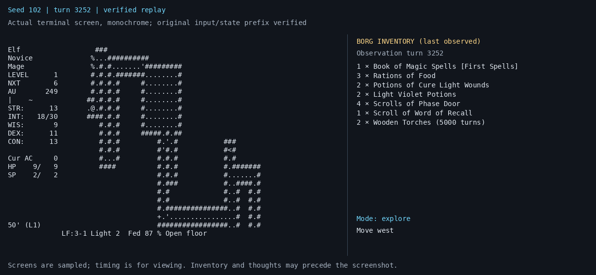

<!-- generated by scripts/death_pages.py -->

# Near-death candidate · seed 102

**Seed: `102`** · borg-reborn-rs

| Detail | Value |
| --- | --- |
| Outcome | recovered to stable |
| Cause | Risk episode; no death at this endpoint |
| Character | Elf Mage |
| Episode boundary | 3252 |
| Endpoint turn | 3262 |
| Program version | [e9a6a521f3ac2fc631aed2c2e3d6c595dde9ab71](https://github.com/diegoami/borg-reborn-rs/commit/e9a6a521f3ac2fc631aed2c2e3d6c595dde9ab71) |

[Read the chronological report](report.md)

## Watch the episode

[Open GIF](media/episode.gif)

Capture: complete. Screens are sampled; side panels show the last available observations.

## Inventory and decisions

- [Inventory, equipment and spells](inventory.md)
- [Written sequence of events and Borg decisions](report.md)

## Try another Borg

**A playable starting save is available.**

[Download starting save](start.save.gz) · [Playback and trial instructions](REPLAY.md)

Saved turn: 3202. Both versions start with fresh Borg memory and the saved engine RNG. The displayed seed identifies the original birth; it does not reseed a loaded scenario.

[Run a scenario comparison](https://github.com/diegoami/borg-cemetery/actions/workflows/try-scenario.yml). Select the cemetery branch/commit containing this directory, paste its repository-relative path as the scenario, and choose the alternative Borg project/version.

## Recording and replay

The GIF is a visual recording of sampled game screens. A complete standalone-recorder input recording was not captured for this episode.

[Read the playback instructions and requirements](REPLAY.md)

[All scenarios](../README.md)

This episode belongs to its original birth. Replays and overlapping episodes are not additional independent lives.
